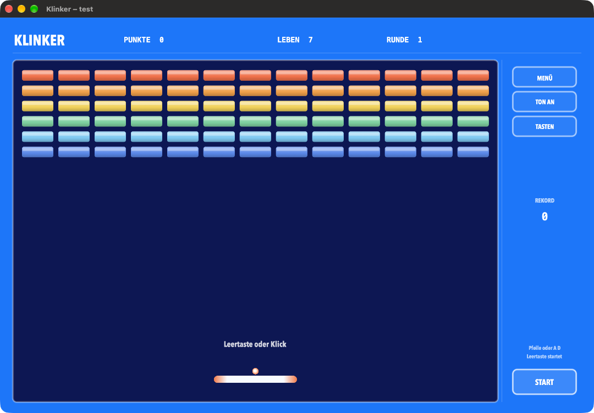

# Klinker



Klinker ist ein Breakout für den Mac und für Windows. Es läuft mit eigenen Bildern und eigenem Ton. 208 feste Runden, nach jeder vierten eine Bonusrunde. Im Startmenü gibt es die Stufen Kinder, Leicht, Mittel und Schwer. Auf dem Mac dazu Spielerprofile.

Mac ab macOS 13. Windows als 64-Bit-Programm.

## Herunterladen

Die Dateien liegen unter [Releases](https://github.com/msebastian100/Klinker/releases).

- **Klinker (M-Serie)** für Apple Silicon
- **Klinker (Intel)** für Intel-Macs
- **Klinker** als Universal-App für beide
- **Klinker.exe** für 64-Bit-Windows

Beim ersten Öffnen auf dem Mac: Rechtsklick auf die App, dann Öffnen. Unter Windows bei der Schutzmeldung auf Weitere Informationen und dann auf Trotzdem ausführen.

## Steuerung

| Taste | Wirkung |
| --- | --- |
| Leertaste, Enter oder Klick | Ball starten |
| Maus | Schläger, wenn Maus gewählt ist |
| Pfeile links und rechts, oder A und D | Schläger, wenn Tasten gewählt sind |
| P oder Escape | Pause |
| M | Ton an oder aus |
| F | Vollbild |
| Befehl-E | Spielerauswahl auf dem Mac |
| Befehl-N, auf Windows Strg-N | Neues Spiel |
| N im Startmenü | Neues Spiel |
| Escape im Startmenü | Zurück zur laufenden Runde |

Maus oder Tasten stellst du im Spiel an der Seite um. Auf dem Mac geht ein Controller zusätzlich. Der Stand wird beim Schließen und zwischendurch gespeichert.

## Bauen

Mac: Xcode-Befehlszeilenwerkzeuge und Python 3.

```bash
bash build.sh
```

Danach liegen die drei Apps in `dist/`.

Windows, vom Mac aus: [Zig](https://ziglang.org) und Python 3.

```bash
bash windows/build.sh
```

Danach liegt `dist/Klinker.exe` bereit.
